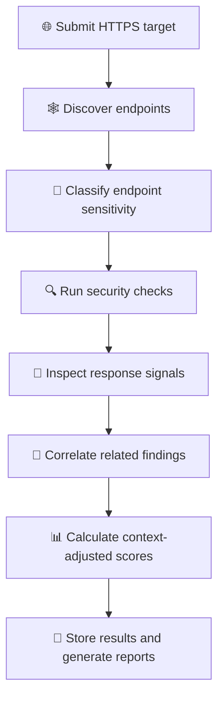
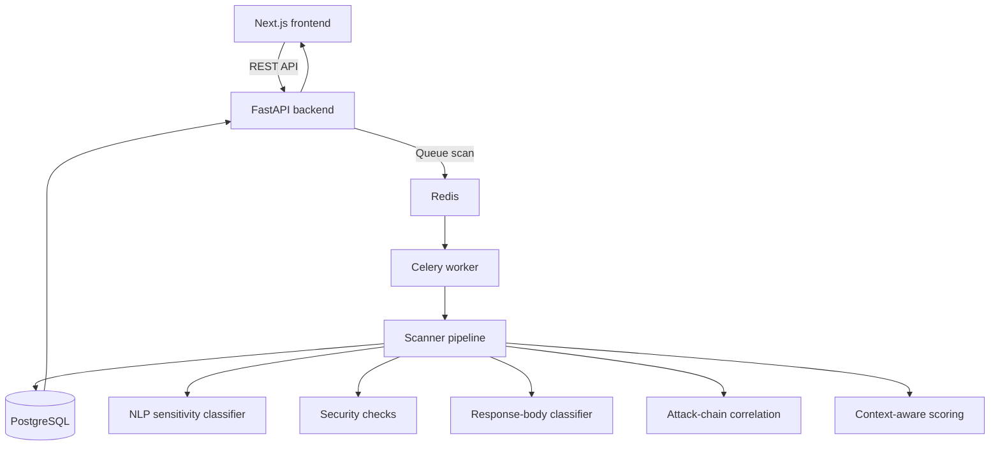

<div align="center">

# 🛡️ CAWASMA

### Context-Aware Web & API Security Misconfiguration Analyzer

**Find the misconfigurations. Understand the context. Prioritize the risk.**

A defensive, black-box security analyzer for HTTPS web applications and REST APIs, built as a BS Computer Science Final Year Project at FAST-NUCES.

<br/>


</div>

---

## 🧭 At a glance

CAWASMA accepts an HTTPS target, discovers endpoints, checks for security misconfigurations, and helps prioritize findings using endpoint sensitivity, response-content signals, and attack-chain correlation.

| 🔎 Discover | 🧪 Assess | 🧠 Prioritize | 📄 Report |
|:---:|:---:|:---:|:---:|
| Find pages and API routes | Run security checks | Add context to findings | Export scan results |

> ⚠️ **Authorized testing only.** Use CAWASMA only on systems you own or have explicit permission to assess. The project is designed around safe, non-destructive checks. It is not intended to exploit vulnerabilities, brute-force credentials, or extract real user data.

## 📚 Contents

- [Why CAWASMA?](#-why-cawasma)
- [How it works](#-how-it-works)
- [Core contributions](#-core-contributions)
- [Context-aware scoring](#-context-aware-scoring)
- [Security checks](#-security-checks)
- [Scope and limitations](#-scope-and-limitations)
- [Architecture](#-architecture)
- [Technology stack](#-technology-stack)
- [Project structure](#-project-structure)
- [Database design](#-database-design)
- [OWASP API Security Top 10](#-owasp-api-security-top-10)
- [Research context](#-research-context)
- [Project plan](#-project-plan)
- [Development checklist](#-development-checklist)

## 🎯 Why CAWASMA?

A finding's practical importance can depend on where it appears and what the endpoint handles. A missing security header on a public information page may have a different impact from the same issue on an authentication or payment endpoint.

CAWASMA explores a way to make scan results more useful by combining:

- **Base CVSS v3.1 scores** associated with individual checks
- **NLP-based endpoint sensitivity** inferred from URL semantics
- **Response-content signals** that may indicate sensitive information
- **Attack-chain correlation** to highlight combinations of findings

The goal is to help analysts move beyond a flat list of findings and make better-informed triage decisions.

## ⚙️ How it works



1. Submit an HTTPS URL through the frontend.
2. Discover endpoints using the crawler.
3. Estimate endpoint sensitivity from URL semantics.
4. Run the configured security checks.
5. Inspect response content for sensitivity signals, with evidence redaction.
6. Correlate related findings against predefined chain templates.
7. Calculate base and context-adjusted scores.
8. Store results and generate reports.

## 💡 Core contributions

### 1. 🧠 NLP-based endpoint sensitivity

The planned classifier uses `all-MiniLM-L6-v2` to compare URL-path semantics against class anchors. It tokenizes paths, expands common abbreviations, creates embeddings, and assigns a sensitivity class.

**Classes:** `CRITICAL` · `HIGH` · `MEDIUM` · `LOW`

| Example path | Intended interpretation |
|---|---|
| `/svc/iam/priv/escalate` | Privilege escalation-related |
| `/ms/billing/stripe/webhook` | Financial transaction-related |
| `/api/v2/usr/auth/mfa/verify` | Authentication-related |
| `/api/rec/fin/txn/init` | Financial transaction initialization |
| `/public/about` | Public informational content |

These are illustrative examples from the project summary, not guaranteed classifier outputs.

### 2. 🔗 Attack-chain correlation

CAWASMA is designed to compare detected findings against five predefined chain templates. When the required findings are present, the tool can group them into a potential chain and calculate a composite score according to the implemented method.

| ID | Example chain | Example score in project notes |
|---|---|---:|
| C001 | XSS → Cookie Theft → Account Takeover | 9.4 |
| C002 | Information Disclosure → Targeted Exploit | 8.2 |
| C003 | CORS → CSRF → Privilege Escalation | 9.6 |
| C004 | Unauthenticated Exposure + BOLA → Data Breach | 9.1 |
| C005 | Exposed `.env` + Version Leak → Full Compromise | 9.8 |

*Scores above are illustrative values from the project summary, not universal or independently validated risk scores.*

### 3. 🧾 Response-body-aware prioritization

The response classifier is intended to identify signals that may indicate sensitive content. Evidence should be redacted before storage or display.

| Signal | Proposed score adjustment |
|---|---:|
| Credentials detected | +3.5 |
| Personally identifiable information (PII) | +2.0 |
| Financial data | +1.5 |
| Internal IP or infrastructure details | +2.0 |

These are project-defined adjustments, not part of the standard CVSS v3.1 formula.

## 📊 Context-aware scoring

The proposed CAWASMA formula is:

\[
\text{Final Score} = \min(10.0,\;(\text{Base CVSS} \times \text{Context Multiplier}) + \text{Response Bonus})
\]

### Context multipliers

| Endpoint sensitivity | Proposed multiplier |
|---|---:|
| 🔴 CRITICAL | × 2.0 |
| 🟠 HIGH | × 1.5 |
| 🟡 MEDIUM | × 1.0 |
| 🟢 LOW | × 0.6 |

### Example

For a finding with a base score of `6.1`:

- A `CRITICAL` endpoint produces an intermediate score of `6.1 × 2.0 = 12.2`.
- The formula caps the final score at `10.0`.
- A `LOW` endpoint produces `6.1 × 0.6 = 3.66` before any response bonus.

> **Scoring note:** This is a proposed CAWASMA context-adjustment method, not standard CVSS v3.1 scoring. Reports should keep the base CVSS score separate from the custom adjusted score and explain the custom method. Score saturation and severity mapping need evaluation.

## 🧪 Security checks

The project summary specifies **58 checks across seven categories**. Verify the final counts against the implementation before release.

<details>
<summary><strong>🛡️ Headers · 12 checks</strong></summary>

- HSTS
- Content Security Policy (CSP)
- X-Frame-Options
- X-Content-Type-Options
- Referrer-Policy
- Permissions-Policy
- Server version disclosure
- X-Powered-By disclosure
- Cross-Origin-Opener-Policy (COOP)
- Cross-Origin-Resource-Policy (CORP)
- Cache-Control
- Expect-CT

</details>

<details>
<summary><strong>🍪 Cookies · 6 checks</strong></summary>

- HttpOnly flag
- Secure flag
- SameSite attribute
- Session token in URL
- Overly broad cookie scope
- Token entropy

</details>

<details>
<summary><strong>🌍 CORS · 5 checks</strong></summary>

- Wildcard origin
- Origin reflection
- Credentials with wildcard origin
- Unsafe cross-origin methods
- Missing max-age

</details>

<details>
<summary><strong>🔐 TLS · 8 checks</strong></summary>

- TLS 1.0 or TLS 1.1 support
- Weak cipher suite
- Certificate expiry
- Self-signed certificate
- Missing HTTP-to-HTTPS redirect
- Mixed content
- Missing HSTS preload
- Hostname mismatch

</details>

<details>
<summary><strong>🔌 REST API · 14 checks</strong></summary>

- Missing rate limiting
- TRACE method enabled
- Unauthenticated data exposure
- Verbose errors or stack traces
- Mass assignment indicators
- BOLA/IDOR indicators
- Missing API versioning
- Deprecated API availability
- Excessive methods advertised through OPTIONS
- JWT misconfiguration indicators
- API over-fetching indicators
- GraphQL introspection indicator
- Secrets in responses
- Injection probe

*GraphQL is otherwise outside the stated full-analysis scope, so the introspection item should be documented as a limited indicator check if retained.*

</details>

<details>
<summary><strong>🔑 Authentication · 7 checks</strong></summary>

- Basic Authentication scheme
- Broken Function Level Authorization indicators
- Weak password-reset token indicators
- Token not invalidated on logout
- Incorrect authentication handling
- Default credentials
- OAuth 2.0 open redirect

</details>

<details>
<summary><strong>🗂️ Information disclosure · 6 checks</strong></summary>

- Internal IP in response
- Directory listing
- Exposed `.env` file
- Exposed `.git` repository
- Exposed backup files
- Public Swagger/API documentation

</details>

## 🎯 Scope and limitations

**In scope**

- HTTPS web applications
- REST APIs using HTTP and JSON
- Black-box assessment without source-code access
- Safe, non-destructive requests, primarily `GET`, `HEAD`, and `OPTIONS`
- Endpoint discovery, misconfiguration checks, and prioritized reporting

**Out of scope or limited**

- SOAP, gRPC, WebSocket protocol testing, and HTTP-only targets
- Full GraphQL security analysis
- Checks that require business-logic knowledge or external callback infrastructure
- Vulnerability claims that cannot be confirmed safely from observable evidence

Some issues, including BOLA/IDOR, mass assignment, and authorization flaws, may require controlled test accounts and test data to validate. CAWASMA should distinguish a possible indicator from a confirmed vulnerability.

## 🏗️ Architecture



The new project summary specifies Next.js, while the earlier README describes React + Vite. Confirm the current repository's actual frontend before treating this diagram as final.

## 🧰 Technology stack

| Component | Technology |
|---|---|
| Frontend | Next.js, as specified in the new project summary |
| Backend | Python, FastAPI |
| Database and ORM | PostgreSQL, SQLAlchemy |
| Migrations | Alembic |
| Background tasks | Celery |
| Queue and progress messaging | Redis |
| HTTP client | `httpx` |
| HTML parsing | BeautifulSoup4 |
| NLP | Sentence Transformers, `all-MiniLM-L6-v2` |
| Response classification | spaCy and regular expressions |
| Reports | JSON, CSV, HTML, PDF, WeasyPrint |
| Optional executive summary | OpenAI or Anthropic API |

The supplied summary lists Python 3.11 and Ubuntu 22.04 as the target environment. Confirm supported versions and system requirements against the actual dependency and deployment files.

## 📁 Project structure

```text
cawasma/
├── backend/
│   ├── app/
│   │   ├── main.py        # FastAPI app factory, CORS, error envelope
│   │   ├── config.py      # typed settings (single source of config)
│   │   ├── core/          # DB-free scanner: engine, crawler, checks/, cvss, reports,
│   │   │                  # sensitivity + body classifiers, chains, tls, pipeline
│   │   ├── api/           # REST + WebSocket routes, Pydantic schemas
│   │   ├── db/            # SQLAlchemy models, session, demo seed
│   │   ├── workers/       # Celery app + scan task
│   │   ├── ml/            # ML classifier interfaces + stubs
│   │   ├── services/      # orchestration + persistence
│   │   └── utils/         # validation, SSRF guard, redaction, logging
│   ├── migrations/        # Alembic
│   ├── tests/             # unit / integration / api
│   ├── pyproject.toml     # dependencies + ruff / mypy / pytest config
│   └── Dockerfile
├── frontend/
├── docs/
├── docker-compose.yml     # api, worker, postgres, redis (+ frontend profile)
├── docker-compose.eval.yml
├── Makefile               # up, down, test, lint, migrate, seed, reset
└── .env.example
```

Run the backend with `make up`, then open http://localhost:8000/health (`make help` lists all targets).

## 🗄️ Database design

The project summary specifies these ten tables:

| Table | Purpose |
|---|---|
| `SCAN` | Scan job records |
| `ENDPOINT` | Discovered endpoints |
| `FINDING` | Security-check results |
| `HEADER` | Captured response headers |
| `COOKIE` | Cookie attributes |
| `TLS_INFO` | TLS and certificate information |
| `ATTACK_CHAIN` | Triggered chain records |
| `CHAIN_FINDING` | Chain-to-finding relationships |
| `AI_INSIGHT` | Executive insight records |
| `FEEDBACK` | Analyst feedback and false-positive corrections |

Confirm names and relationships against the actual SQLAlchemy models and migrations.

## 🧩 OWASP API Security Top 10 (2023)

The current project summary describes the following intended coverage:

| Category | Intended coverage |
|---|---|
| API1: Broken Object Level Authorization | Covered, validation may be limited |
| API2: Broken Authentication | Covered |
| API3: Broken Object Property Level Authorization / Mass Assignment | Covered |
| API4: Unrestricted Resource Consumption | Covered |
| API5: Broken Function Level Authorization | Partial |
| API6: Unrestricted Access to Sensitive Business Flows | Not covered |
| API7: Server Side Request Forgery | Not covered |
| API8: Security Misconfiguration | Core focus |
| API9: Improper Inventory Management | Partial |
| API10: Unsafe Consumption of APIs | Not covered |

This is a planned coverage map from the project summary. Confirm each claim against implementation and test evidence.

## 🔬 Research context

The supplied project summary identifies these works as relevant to the research direction:

- Wunder et al. (2024), manual CVSS scoring consistency
- Golmohammadi et al. (2023), API security research and context-aware scoring
- Molnár and Bilicki (2022), comparison of security scanners
- Ahmadi Mehri et al. (2022), ACVRM and asset-inventory requirements

**Before academic submission:** Verify titles, publication details, exact findings, and all numerical claims against the original papers. Add complete citations or DOI links when confirmed.

## 🗓️ Project plan

**Methodology:** Agile Scrum · **Sprint length:** 2 weeks · **Team:** 3 members

| Sprint | Planned work |
|---|---|
| 1 | Research, literature review, architecture |
| 2 | Scanner engine, crawler, security checks |
| 3 | NLP, chain correlation, response classifier, scoring |
| 4 | Backend, frontend, Celery integration |
| 5 | Testing, evaluation, bug fixes |
| 6 | Final report, slides, demonstration |

The project summary maps the work to CLO2 (design and implementation), CLO3 (working demonstration), CLO4 (project management), and CLO5 (teamwork).

## 📐 Design diagrams

The project summary lists the following planned or produced design artifacts:

- Use Case Diagram, draw.io XML
- Activity Diagram, PlantUML
- Flow Diagram, Mermaid
- System Architecture Diagram, PlantUML
- Deployment Diagram, PlantUML
- Class Diagram, PlantUML
- Component Diagram, PlantUML
- ER Diagram, Mermaid
- State Machine Diagram, PlantUML
- Three Sequence Diagrams, PlantUML

Add links to the actual diagram files when their repository paths are confirmed.

## ✅ Development checklist

- [ ] Confirm the actual frontend framework and folder structure.
- [ ] Verify the 58 checks and seven category counts.
- [ ] Document tested setup commands and required environment variables.
- [ ] Verify Docker Compose services and deployment behavior.
- [ ] Confirm database models and migration status.
- [ ] Confirm API routes and progress updates.
- [ ] Separate indicators from confirmed vulnerabilities.
- [ ] Document the base CVSS and custom context-adjustment method.
- [ ] Test evidence redaction for sensitive response content.
- [ ] Verify research references against the original publications.
- [ ] Confirm report formats and optional LLM integration.

---

<div align="center">

**CAWASMA** · Context-aware security analysis for better-informed triage.

Built as a Final Year Project at **FAST-NUCES, Pakistan**.

</div>
