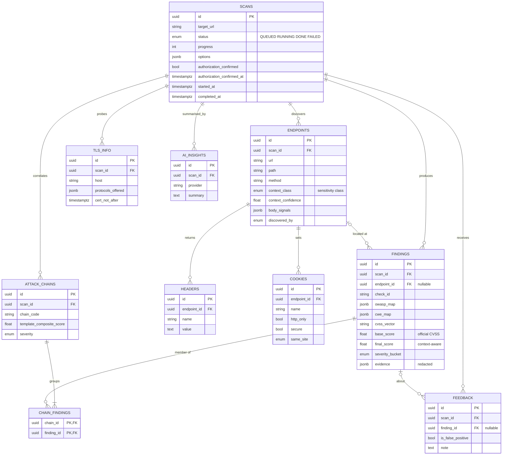

# CAWASMA database schema

PostgreSQL 16 in Docker and CI; SQLite for the quick test runs. Defined by the
SQLAlchemy models in `backend/app/db/models/` and created by the Alembic
migration `backend/migrations/versions/0001_initial_schema.py`. Why things are
the way they are: [db-decisions.md](db-decisions.md).

Conventions for every table: UUID primary key `id`; `created_at` and
`updated_at` (timestamptz, set by the database), omitted from the tables
below. "JSON" columns are JSONB on PostgreSQL.

## Tables

| Table | One row per | Parent (on delete) |
|-------|-------------|--------------------|
| `scans` | scan job of a target URL | (root) |
| `endpoints` | URL + method discovered in a scan | `scans` (cascade) |
| `findings` | security finding from a check | `scans` (cascade); `endpoints` (set null) |
| `headers` | security-relevant response header (redacted) | `endpoints` (cascade) |
| `cookies` | cookie **metadata**; the value is never stored | `endpoints` (cascade) |
| `tls_info` | TLS / certificate facts for the scanned host | `scans` (cascade) |
| `attack_chains` | correlated chain of findings | `scans` (cascade) |
| `chain_findings` | link: which findings form a chain | `attack_chains`, `findings` (cascade) |
| `ai_insights` | executive summary text | `scans` (cascade) |
| `feedback` | analyst note / false-positive flag | `scans` (cascade); `findings` (cascade, optional) |

Deleting a scan deletes everything under it. Deleting an endpoint keeps its
findings (their `endpoint_id` becomes null).

### scans

| Column | Type | Notes |
|--------|------|-------|
| `target_url` | string, required | HTTPS URL; a "target" is this value (no separate table) |
| `status` | enum, required | `QUEUED` → `RUNNING` → `DONE` / `FAILED`. The API still shows `DONE` as `COMPLETED` |
| `progress`, `current_stage` | int, string | 0–100 and a human-readable stage |
| `options` | JSON, required | limits the scan ran with, e.g. `{"max_endpoints": 200, "max_crawl_depth": 2}` |
| `authorization_confirmed` | bool, required | operator confirmed they may test the target |
| `authorization_confirmed_at` | timestamptz | set exactly when the flag is true (DB constraint) |
| `started_at`, `completed_at`, `duration_seconds` | timestamptz, float | |
| `error_message` | text | why a scan failed |

### endpoints

| Column | Type | Notes |
|--------|------|-------|
| `scan_id` | FK, required | |
| `url`, `path`, `method` | string, required | unique per scan (`scan_id`, `url`, `method`) |
| `status_code`, `content_type`, `response_time` | int, string, float | |
| `context_class` | enum | **sensitivity class** from the NLP classifier: `CRITICAL` / `HIGH` / `MEDIUM` / `LOW` |
| `context_confidence`, `context_reason` | float, JSON list | classifier confidence and human-readable reasons |
| `body_signals` | JSON, required | `{"credentials", "pii", "financial", "internal_ip": bool, "bonus": float, "reasons": [str]}`, or `{}` if no body was analysed |
| `discovered_by` | enum | `SEED`, `HTML`, `JAVASCRIPT`, `WORDLIST`, `RECURSIVE` |

### findings

| Column | Type | Notes |
|--------|------|-------|
| `scan_id` | FK, required | |
| `endpoint_id` | FK | null for host-level findings (e.g. TLS) |
| `check_id` | string, required | catalog rule, e.g. `HDR-003` |
| `title`, `category`, `description` | string, enum, text | category: `HEADERS`, `COOKIES`, `CORS`, `TLS`, `REST_API`, `AUTH`, `INFO_DISCLOSURE` |
| `owasp_map` | JSON list, required | e.g. `["API8:2023"]` (`[]` until the catalog has mappings) |
| `cwe_map` | JSON list, required | e.g. `["CWE-1021"]` |
| `cvss_vector` | string, required | official CVSS v3.1 base vector of the check |
| `base_score` | float, required | official CVSS v3.1 base score, never modified |
| `context_class`, `context_confidence` | enum, float | copied from the endpoint at scoring time |
| `cawasma_context_multiplier`, `response_bonus` | float | inputs to the context-aware score |
| `final_score` | float, required | CAWASMA context-aware score (not an official CVSS value) |
| `severity_bucket` | enum, required | `CRITICAL` ≥ 9.0, `HIGH` ≥ 7.0, `MEDIUM` ≥ 4.0, `LOW` ≥ 0.1, `INFO` |
| `evidence` | JSON, required | redacted: `{"text": "summary", ...check-specific keys}` |
| `impact`, `recommendation`, `references`, `limitation` | text, text, JSON list, text | |

### Other tables

- **headers**: `endpoint_id`, `name`, `value` (redacted where sensitive).
- **cookies**: `endpoint_id`, `name`, `value_length`, `http_only`, `secure`,
  `same_site` (`STRICT` / `LAX` / `NONE` / `UNSET`), `domain`, `path`.
- **tls_info**: `scan_id`, `host`, `protocols_offered` (JSON list),
  `negotiated_protocol`, `negotiated_cipher`, `cert_subject`, `cert_issuer`,
  `cert_not_after`, `is_self_signed`, `hostname_matches`.
- **attack_chains**: `scan_id`, `chain_code` (e.g. `C005`), `name`,
  `description`, `template_composite_score` (documented template value, not a
  computed CVSS), `severity`.
- **chain_findings**: `chain_id`, `finding_id` (composite primary key).
- **ai_insights**: `scan_id`, `provider` (`builtin`, `openai`, `anthropic`), `summary`.
- **feedback**: `scan_id`, `finding_id` (optional), `is_false_positive`, `note`.

## ER diagram



## Working with it

```bash
make reset     # drop everything, apply migrations, load sample data
make seed      # sample data only: 1 target, 2 scans, 10 endpoints, 16 findings, 1 chain
make migrate   # apply new migrations
cd backend && alembic revision --autogenerate -m "describe change"   # after changing a model
```

Schema changes always go through a new migration; CI fails if the models and
migrations drift (`alembic check`).
